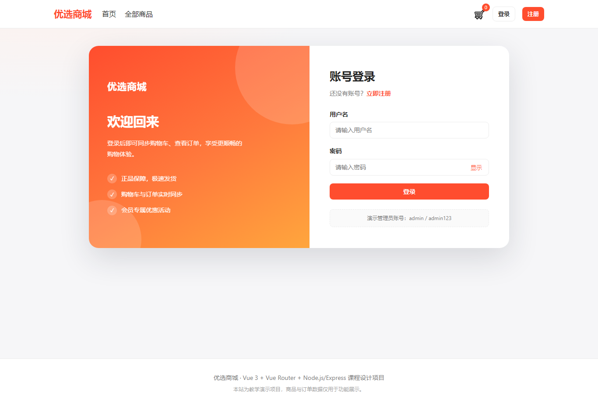

# 优选商城 · Shopping Site

一个包含两套可独立运行实现的购物网站：

- **Node.js 版**：前台 Vue 3 + Vue Router 单页应用（SPA），后台 EJS 服务端渲染，Express 提供 JSON 接口，使用 JSON 文件存储，零数据库依赖，克隆即跑。
- **PHP 版**：位于 `php/` 目录，PHP 8 + PDO + MySQL 服务端渲染，包含用户系统、验证码、Cookie/Session、图片上传、搜索分页、自定义分类承接表、扫码支付下单与后台管理。

两套实现采用同一套日漫天空樱花主题，可分别启动、互不影响。

[](https://nodejs.org)
[](https://vuejs.org)
[](https://router.vuejs.org)
[](https://expressjs.com)
[](https://www.php.net)
[](https://www.mysql.com)
[](LICENSE)

> 学习与演示项目，适合作为前端框架 / 全栈入门练手，或应届生简历中的实战作品。

## ✨ 功能特性

- 🛍️ **商品浏览与搜索**：首页推荐、分类筛选、关键词搜索、价格排序、商品详情
- 🛒 **购物车**：加购、改数量、删除、清空、金额实时合计（存于 session）
- 👤 **用户系统**：注册、登录、退出，密码使用 bcrypt 加密存储
- 💳 **扫码支付下单（PHP 版）**：提交结算后先写入待支付表并弹出收款二维码，确认支付后才生成正式订单、扣减库存
- 🗂️ **自定义分类承接表（PHP 版）**：后台新增商品时可创建新分类，自动生成 `products_cat_<分类ID>` 表并同步商品与库存
- 🧑‍💼 **后台管理**：仪表盘统计（商品/订单/用户/营收）、商品增删改、订单状态流转、用户列表
- 🎨 **日漫主题 UI**：蓝天樱花、夜景登录、角色贴纸按钮、云层与花瓣动效，两套前端同步
- 🎬 **交互体验**：页面切换过渡、列表增删动画、骨架屏、全局提示、二维码支付弹窗、响应式适配
- 🔐 **PHP 版安全能力**：GD 图形验证码、`password_hash()` 密码加密、CSRF Token、PDO 预处理防 SQL 注入、上传文件类型校验
- 🗄️ **MySQL 数据层**：6 张核心表（用户、分类、商品、订单、订单明细、待支付订单）+ 按分类动态生成的承接表，外键与 CHECK 约束
- 📤 **图片上传**：后台上传商品图片，限制 JPG / PNG / GIF / WEBP 且不超过 2MB
- 📄 **搜索与分页**：关键词搜索、分类筛选、价格排序，前台 6 条/页、后台 10 条/页

## 🧱 技术架构

本项目包含两套实现：

### Node.js + Express 版

- **前台**：Vue 3（组合式 API）+ Vue Router 4，单页应用，10 个路由视图（含 404）
- **后台**：EJS 服务端渲染，通过 `/admin` 访问，`requireAdmin` 中间件鉴权
- **服务端**：Express 提供 `/api` 下的 JSON 接口，`express-session` 维护登录态与购物车
- **数据层**：JSON 文件（`data/products.json`、`users.json`、`orders.json`）

### PHP + MySQL 版

- **前台 / 后台**：PHP 8 服务端渲染，原生 HTML/CSS（复用同一套日漫主题样式）
- **数据层**：MySQL 8 + PDO 预处理，`php/database/schema.sql` 创建 6 张核心表；新增分类时自动生成 `products_cat_<分类ID>` 承接表
- **安全**：Session 登录态、Cookie 记住用户名、CSRF Token、图形验证码、`password_hash()`、上传白名单
- **购物车与订单**：购物车存于 Session；提交结算先写入 `pending_orders`，确认支付后才生成正式订单、锁定并扣减库存
- **扫码支付**：支付页弹出收款二维码，演示模式点击“我已完成支付”即视为支付成功，不校验实际支付金额

> 自定义分类承接表与扫码支付依赖 MySQL 表结构，仅在 PHP 版提供；Node.js 版使用 JSON 文件存储。

#### 数据库表

| 表名 | 说明 |
| --- | --- |
| `users` | 用户与管理员账号 |
| `categories` | 商品分类 |
| `products` | 商品主表 |
| `orders` | 支付成功后生成的正式订单 |
| `order_items` | 订单商品明细快照 |
| `pending_orders` | 待支付订单，保存收货信息、商品快照与支付状态 |
| `products_cat_<ID>` | 每个分类动态生成的商品承接表，与 `products` 按商品 ID 一对一同步 |

> 改造原则：保留原有全部业务功能与后台实现，仅将面向用户的前台重构为 SPA；原有服务端表单路由继续保留以兼容旧链接。PHP 版为独立实现，不影响 Node.js 版运行。

### 💳 支付流程（PHP 版）

```text
提交结算
  → 写入 pending_orders（待支付表，不扣库存、不生成正式订单）
  → 弹出二维码支付弹窗
  → 点击“我已完成支付”
  → 事务生成 orders / order_items
  → 扣减库存并同步 products_cat_<ID>
  → 跳转订单详情
```

支付前不会在「我的订单」中出现该笔订单；确认支付后才会展示完整订单信息。

### 🗂️ 自定义分类承接表（PHP 版）

```text
后台新增/编辑商品 → 填写“新建分类”
  → 写入 categories
  → 自动创建 products_cat_<分类ID>
  → 商品写入 products 并同步到承接表
```

商品切换分类、删除商品、下单扣库存时，承接表都会同步更新。

## 📸 界面预览

> 当前两套前端均已切换为日漫天空樱花主题；下列截图为功能页面示例，最新效果以实际运行为准。

| 首页 | 商品列表 |
| --- | --- |
|  |  |

| 商品详情 | 购物车 |
| --- | --- |
|  |  |

| 登录 | 注册 |
| --- | --- |
|  |  |

| 结算 | 后台仪表盘 |
| --- | --- |
|  |  |

## 🚀 快速开始

### 方式一：Node.js + JSON 版

环境要求：**Node.js ≥ 18**

```bash
# 1. 安装依赖
npm install

# 2. 启动服务
npm start
```

打开浏览器访问 <http://localhost:3000>。

首次启动会自动生成 `data/` 目录、12 件种子商品和默认管理员账号。

### 方式二：PHP + MySQL 版

环境要求：**PHP ≥ 8.0**（启用 `pdo_mysql`、`gd` 扩展）、**MySQL 8.0**

1. 新建本机配置 `php/config.local.php`（该文件已加入 `.gitignore`）：

```php
<?php
return [
    'host' => '127.0.0.1',
    'port' => 3306,
    'name' => 'shopping_php',
    'user' => 'root',
    'pass' => '你的数据库密码',
];
```

也可以用环境变量 `SHOP_DB_HOST`、`SHOP_DB_PORT`、`SHOP_DB_NAME`、`SHOP_DB_USER`、`SHOP_DB_PASS` 覆盖。

2. 初始化数据库（二选一）：

- 浏览器访问 <http://127.0.0.1:8080/install.php>，点击“开始安装”
- 或命令行执行 `php php/install.php`

安装脚本会创建 6 张核心表（含 `pending_orders` 待支付表），并为现有分类创建 `products_cat_<分类ID>` 承接表。

3. 启动 PHP 内置服务器：

```bash
php -S 127.0.0.1:8080 -t php
```

打开浏览器访问 <http://127.0.0.1:8080>。也可以项目根目录为站点根目录启动，再访问 `/php/`。

4. 支付演示：

结算提交后进入扫码支付弹窗，点击“我已完成支付”即模拟支付成功，不校验实际金额。收款二维码位于 `php/assets/img/payment-qr.png`，可替换为自己的收款码。

## 🔑 默认账号

两套实现使用相同的默认管理员账号：

| 角色   | 用户名 | 密码     |
| ------ | ------ | -------- |
| 管理员 | admin  | admin123 |

> ⚠️ 演示账号仅用于本地开发，部署前请务必修改。

## 📁 目录结构

```
shopping-site/
├── server.js                 # Node.js 服务端入口
├── package.json
├── src/                      # Node.js 数据层与路由
│   ├── store.js
│   ├── middleware.js
│   └── routes/
├── views/                    # Node.js 后台 EJS 模板
├── public/                   # Vue SPA 前端资源
├── php/                      # PHP + MySQL 版（可独立部署）
│   ├── index.php             # 商品列表（搜索 / 分类 / 排序 / 分页）
│   ├── product.php           # 商品详情
│   ├── cart.php              # 购物车（Session）
│   ├── checkout.php          # 结算，写入待支付订单
│   ├── pay.php               # 二维码支付页
│   ├── orders.php            # 我的订单
│   ├── order.php             # 订单详情
│   ├── register.php          # 注册
│   ├── login.php             # 登录
│   ├── logout.php            # 退出
│   ├── profile.php           # 资料 / 密码修改
│   ├── captcha.php           # GD 图形验证码
│   ├── config.php            # 应用与数据库配置
│   ├── config.local.php      # 本机私有配置（已 gitignore）
│   ├── db.php                # PDO 连接
│   ├── install.php           # 安装 / 初始化脚本
│   ├── database/schema.sql   # 建库建表、约束与种子数据
│   ├── includes/             # header / footer / functions / auth
│   │   ├── categories.php    # 分类承接表创建与同步
│   │   └── payments.php      # 支付确认与正式订单生成
│   ├── admin/                # 后台仪表盘、商品、订单、用户
│   ├── assets/               # CSS / JS / 日漫主题图片 / 收款码
│   └── uploads/products/     # 商品图片上传目录
├── scripts/reset.js          # 重置 JSON 数据脚本
├── docs/                     # 设计报告与界面截图
└── data/                     # Node.js 运行时数据（已 gitignore）
```

## 🛠️ 技术栈

| 依赖 | 用途 |
| --- | --- |
| [Vue 3](https://vuejs.org) | 前台框架（组合式 API） |
| [Vue Router 4](https://router.vuejs.org) | 前台路由与导航守卫 |
| [Express 4](https://expressjs.com) | Web 框架与 JSON 接口 |
| [EJS](https://ejs.co) | 后台管理模板引擎 |
| [express-session](https://github.com/expressjs/session) | 会话管理（登录态 + 购物车） |
| [bcryptjs](https://github.com/dcodeIO/bcrypt.js) | 密码加密 |
| [method-override](https://github.com/expressjs/method-override) | 表单支持 PUT / DELETE |
| [PHP 8](https://www.php.net) | PHP 版服务端与页面渲染 |
| [MySQL 8](https://www.mysql.com) | PHP 版数据库 |
| [PDO](https://www.php.net/manual/zh/book.pdo.php) | 预处理查询与事务 |

## 📄 设计报告

课程设计报告见 `docs/优选商城-前端技术课程设计报告.docx`（含需求分析、功能结构图、各模块实现与效果图、课程评分点对照及总结），同目录下提供 PDF 版本便于预览。

## 🧑‍💻 常用脚本

| 命令 | 说明 |
| --- | --- |
| `npm start` | 启动服务（常规模式） |
| `npm run dev` | 启动开发模式（文件变更自动重启） |
| `npm run reset` | 清空 `data/` 目录，重启后重新生成种子数据 |
| `php -S 127.0.0.1:8080 -t php` | 启动 PHP 版（内置服务器） |
| `php php/install.php` | 命令行初始化 MySQL 数据库 |

## 📝 环境变量

复制 `.env.example` 为 `.env`（已 gitignore），按需修改：

| 变量 | 默认值 | 说明 |
| --- | --- | --- |
| `PORT` | `3000` | 服务端口 |
| `SESSION_SECRET` | 开发用默认值 | 会话加密密钥，生产环境务必修改 |

PHP 版不使用 `.env`，支持以下环境变量（优先级高于 `php/config.local.php`）：

| 变量 | 默认值 | 说明 |
| --- | --- | --- |
| `SHOP_DB_HOST` | `127.0.0.1` | 数据库地址 |
| `SHOP_DB_PORT` | `3306` | 数据库端口 |
| `SHOP_DB_NAME` | `shopping_php` | 数据库名 |
| `SHOP_DB_USER` | `root` | 数据库用户 |
| `SHOP_DB_PASS` | 空 | 数据库密码 |

## ❓ FAQ

**端口被占用怎么办？**

```bash
PORT=3001 npm start
```

**如何重置数据？**

```bash
npm run reset
npm start
```

**图片加载慢或无法显示？**

种子数据使用 [picsum.photos](https://picsum.photos) 占位图，需联网。替换成本地图片可修改 `data/products.json` 中的 `image` 字段。

**购物车数据会丢吗？**

购物车存于服务端 session，浏览器关闭后按会话 cookie 有效期（默认 1 天）保留；生产部署建议改用持久化存储（如 Redis）。

**PHP 版提示数据库连接失败？**

确认 MySQL 已启动，并在 `php/config.local.php` 中填写正确的账号密码；首次运行请访问 `php/install.php` 初始化数据库。

**支付二维码在哪里替换？**

替换 `php/assets/img/payment-qr.png` 即可。演示模式不会校验实际支付金额，点击“我已完成支付”就会生成正式订单。

**为什么支付前在「我的订单」里看不到订单？**

提交结算后数据先写入 `pending_orders` 待支付表；确认支付成功后才会生成 `orders` / `order_items` 并扣减库存。

**PHP 版 8080 端口被占用？**

```bash
php -S 127.0.0.1:8081 -t php
```

## 📄 License

[MIT](LICENSE)

## ⚠️ 免责声明

本项目仅用于学习与演示，请勿直接用于生产环境。
