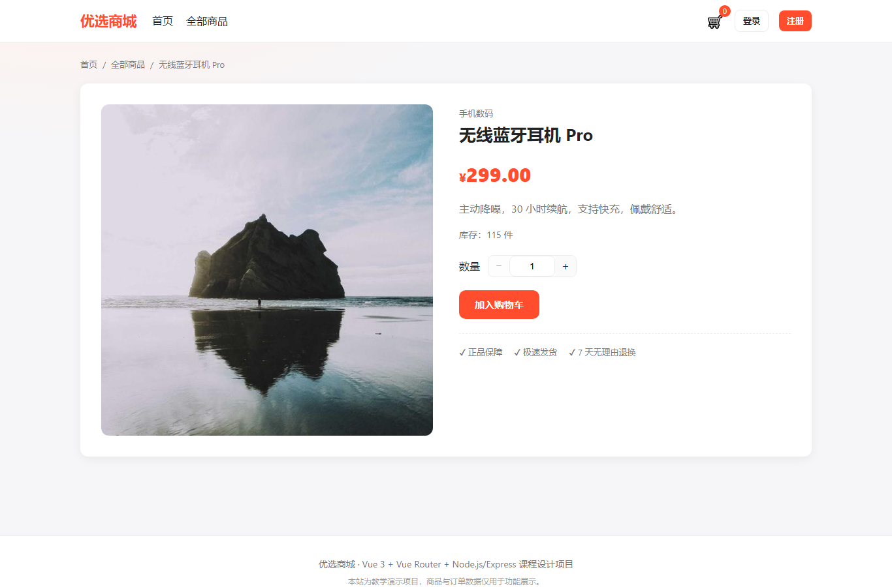
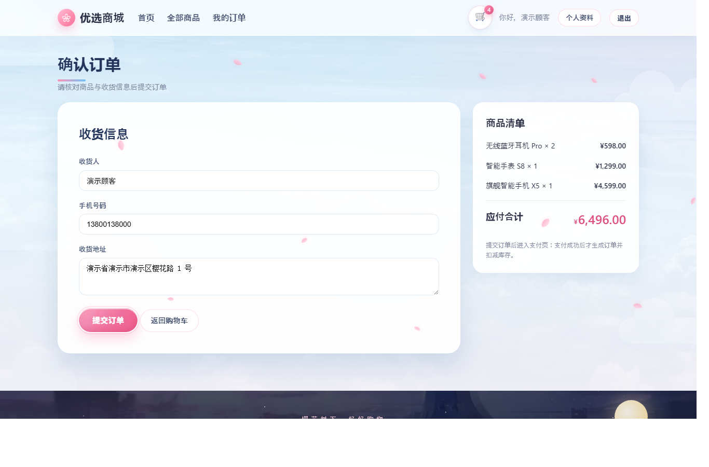

# 优选商城 · Shopping Site

一个开箱即用的购物网站，基于 **Node.js + Express + EJS** 构建，使用 **JSON 文件**存储数据，零数据库依赖，克隆即跑。

[](https://nodejs.org)
[](https://expressjs.com)
[](https://ejs.co)
[](LICENSE)

> 学习与演示项目，适合作为 Express 全栈入门练手，或应届生简历中的实战作品。

## ✨ 功能特性

- 🛍️ **商品浏览与搜索**：分类筛选、关键词搜索、价格排序、商品详情页
- 🛒 **购物车**：加购、改数量、删除、清空、金额实时合计（存于 session）
- 👤 **用户系统**：注册、登录、退出，密码使用 bcrypt 加密存储
- 📦 **下单结账**：收货信息表单校验、提交订单、自动扣减库存、订单详情
- 🧑‍💼 **后台管理**：仪表盘统计（商品/订单/用户/营收）、商品增删改、订单状态流转、用户列表
- 📱 **响应式界面**：自写 CSS，桌面/移动端均可用

## 📸 界面预览

| 首页 | 商品列表 |
| --- | --- |
|  |  |

| 商品详情 | 购物车 |
| --- | --- |
|  |  |

| 结算页 | 后台仪表盘 |
| --- | --- |
|  |  |

> 截图尚未生成时，可参考 [docs/screenshots/README.md](docs/screenshots/README.md) 在本地一键补全。

## 🚀 快速开始

环境要求：**Node.js ≥ 18**

```bash
# 1. 克隆仓库
git clone https://github.com/<your-name>/shopping-site.git
cd shopping-site

# 2. 安装依赖
npm install

# 3. 启动服务
npm start
```

打开浏览器访问 <http://localhost:3000>。

首次启动会自动生成 `data/` 目录、12 件种子商品和默认管理员账号。

## 🔑 默认账号

| 角色   | 用户名 | 密码     |
| ------ | ------ | -------- |
| 管理员 | admin  | admin123 |

> ⚠️ 演示账号仅用于本地开发，部署前请务必修改。

## 📁 目录结构

```
shopping-site/
├── server.js                 # 服务端入口
├── package.json
├── src/
│   ├── store.js              # 数据层（JSON 读写 + 增删改查）
│   ├── middleware.js         # 全局中间件与鉴权
│   └── routes/
│       ├── index.js          # 首页
│       ├── products.js       # 商品列表 / 详情
│       ├── cart.js           # 购物车
│       ├── auth.js           # 注册 / 登录 / 退出
│       ├── orders.js         # 结算 / 订单
│       └── admin.js          # 后台管理
├── views/                    # EJS 模板
│   ├── partials/             # 公共头部 / 尾部
│   ├── index.ejs
│   ├── products/             # 商品页
│   ├── cart/                 # 购物车
│   ├── auth/                 # 登录注册
│   ├── orders/               # 结算 / 订单
│   └── admin/                # 后台页面
├── public/css/style.css      # 全局样式
├── scripts/reset.js          # 重置数据脚本
├── docs/screenshots/         # 界面截图
└── data/                     # 运行时自动生成（已 gitignore）
```

## 🛠️ 技术栈

| 依赖 | 用途 |
| --- | --- |
| [Express 4](https://expressjs.com) | Web 框架 |
| [EJS](https://ejs.co) | 服务端模板引擎 |
| [express-session](https://github.com/expressjs/session) | 会话管理（登录态 + 购物车） |
| [bcryptjs](https://github.com/dcodeIO/bcrypt.js) | 密码加密 |
| [method-override](https://github.com/expressjs/method-override) | 表单支持 PUT / DELETE |

## 🧑‍💻 常用脚本

| 命令 | 说明 |
| --- | --- |
| `npm start` | 启动服务（生产/常规模式） |
| `npm run dev` | 启动开发模式（文件变更自动重启） |
| `npm run reset` | 清空 `data/` 目录，重启后重新生成种子数据 |

## 📝 环境变量

复制 `.env.example` 为 `.env`（已 gitignore），按需修改：

| 变量 | 默认值 | 说明 |
| --- | --- | --- |
| `PORT` | `3000` | 服务端口 |
| `SESSION_SECRET` | 开发用默认值 | 会话加密密钥，生产环境务必修改 |

## ❓ FAQ

**端口被占用怎么办？**

```bash
PORT=3001 npm start
```

**如何重置数据？**

```bash
npm run reset
npm start
```

**图片加载慢或无法显示？**

种子数据使用 [picsum.photos](https://picsum.photos) 占位图，需联网。替换成本地图片可修改 `data/products.json` 中的 `image` 字段。

**购物车数据会丢吗？**

购物车存于服务端 session，浏览器关闭后按会话 cookie 有效期（默认 1 天）保留；生产部署建议改用持久化存储（如 Redis）。

## 📄 License

[MIT](LICENSE)

## ⚠️ 免责声明

本项目仅用于学习与演示，请勿直接用于生产环境。
